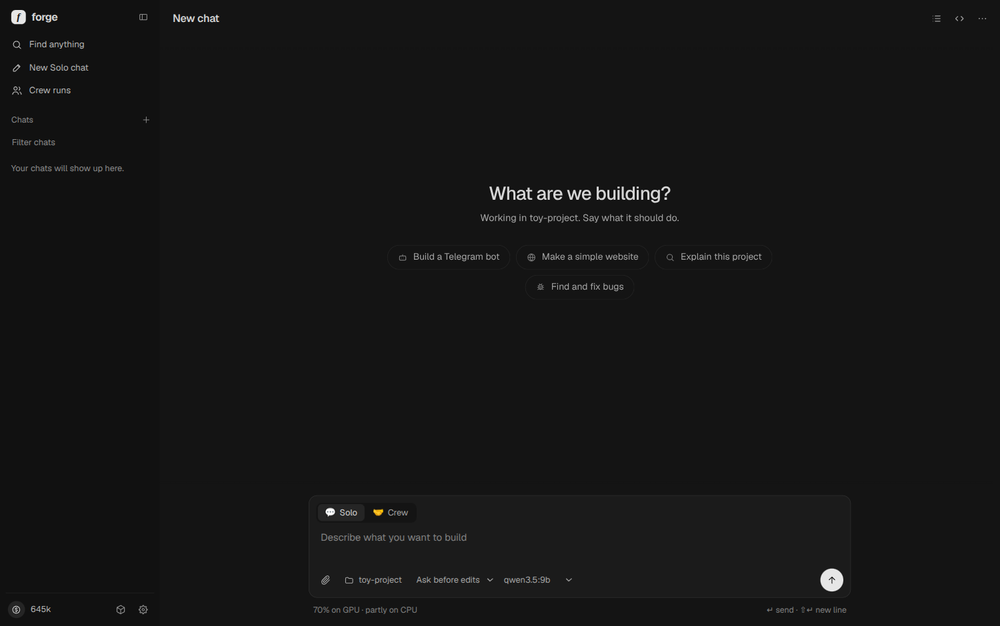
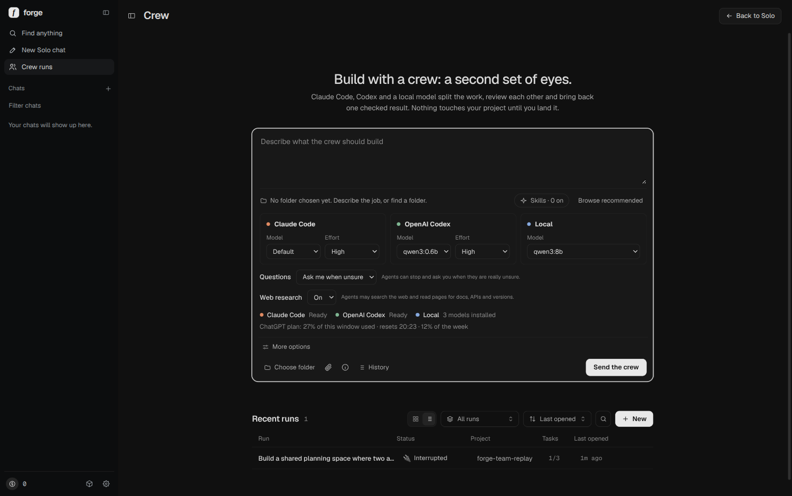
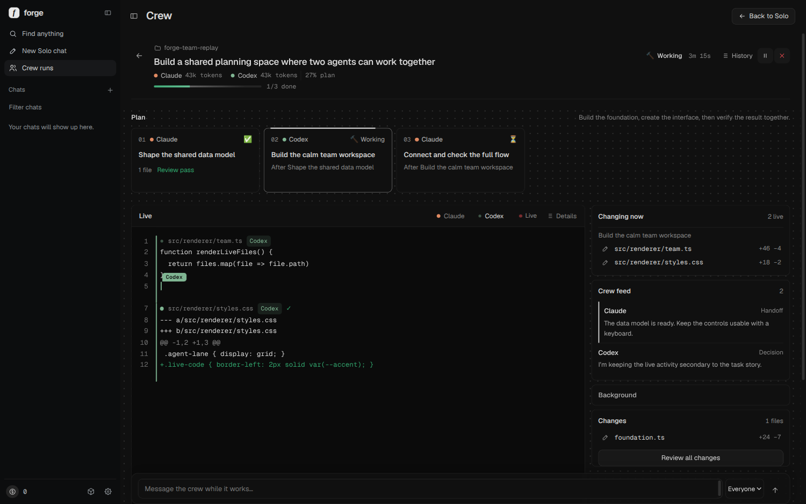
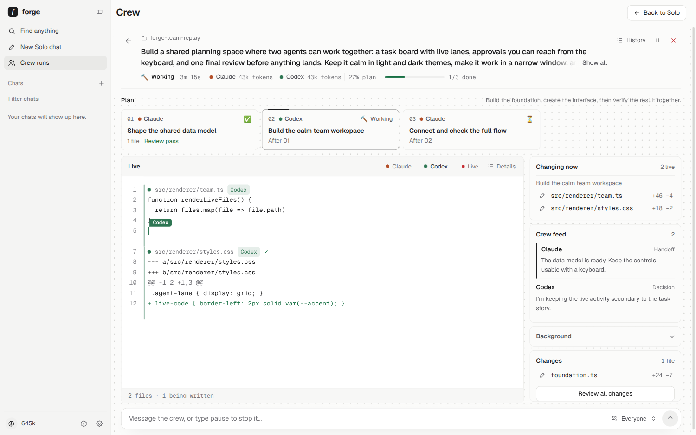
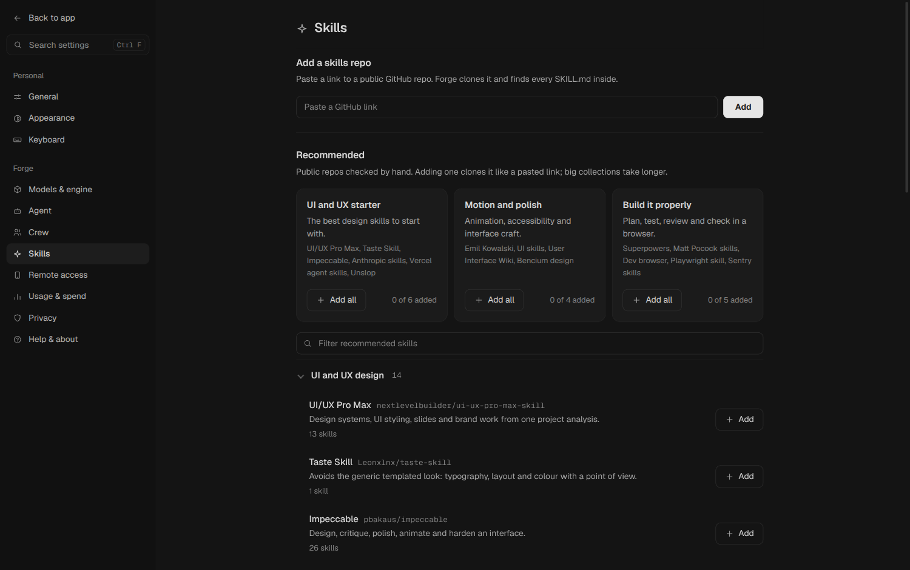
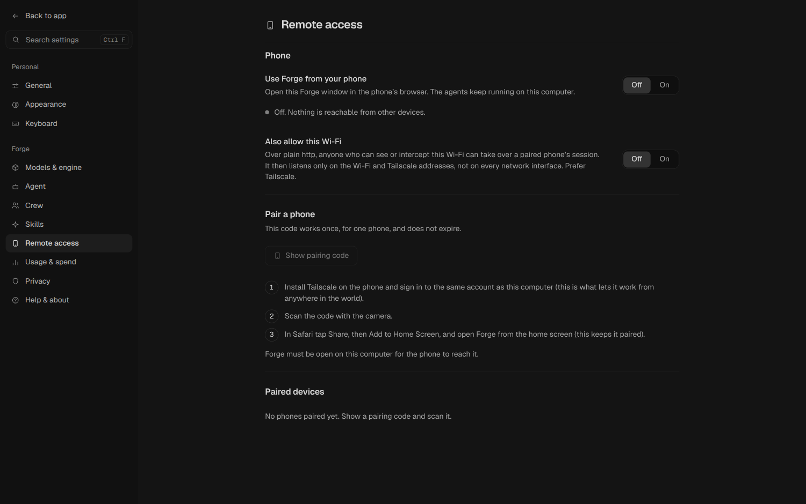

# Forge

A desktop app that builds software for you. Describe what you want in a chat; an AI agent creates and edits the files on your computer, runs commands and tests, and asks you for what it still needs. It works with local models through Ollama, with your own API keys (Anthropic, OpenAI, OpenRouter), or as a **Crew** of Claude Code, Codex and a local model on your existing subscriptions.

The editor, file tree and terminal exist but stay hidden behind the **Workspace** button. The app opens as a chat.


## Two ways to work

**Solo** is one agent in a chat. **Crew** is Claude Code, OpenAI Codex and a local Ollama model working on the same goal as a team, on your own subscriptions (no API keys, no per-token billing).



### Crew

Describe a goal. A planner splits it into tasks, the tasks run in their own git branches (in parallel where they can), a different agent reviews each one, everything merges on a team branch, your project's checks run, and you press **Apply**. Nothing touches your folder before that, and Undo takes it back out.



- **Watch it live.** One shared editor shows every agent typing its code side by side, with the files that are changing and a feed of what the agents tell each other.
- **A chat that never ends.** The message box at the bottom of a run is always there. While the crew works your message steers it; when the result is waiting or already applied, the same message reopens the same run with a new task. You keep working in one place.
- **Agents ask you questions** inside the app, with choices, instead of guessing.
- **Local model is always checked.** Anything the local model writes is reviewed by Claude or Codex before it counts (if only the local model is ready it reviews its own work, and Forge says so).
- **Web research.** Agents can search the web and read pages.
- **Attachments.** Paste or drop photos, files and videos (a video becomes frames the agents can read), also in Solo chats.
- **Skills.** Paste a GitHub repo link and Forge clones it; Claude and Codex use the `SKILL.md` files inside. There is a hand-checked catalog of 50 UI/UX, motion and engineering skill repos to add with one click.
- **Project history.** Every run appends to a history file in the project so any agent knows what happened so far.
- **Folder finder.** Describe the job and Forge scans your computer for the folder it belongs in.
- **Models and effort visible.** The model and reasoning effort of Claude and Codex are shown and set per run. No budget or allowance limit unless you set one.
- **Background.** Crew notes and check results stay tucked in a collapsed Background row.





### Skills and usage



Token use is counted per day for Claude, Codex and Local, with an all-time total and a per-model table (Settings > Usage & spend).

### Use it from your phone

Forge can serve itself to your phone, so the agents keep running on your computer while you steer from anywhere. Turn on **Settings > Remote access**, install Tailscale on both devices, scan the one-time pairing code, then Add to Home Screen in Safari. The session is renewed while the phone is in use, and nothing is exposed to the internet when Tailscale is used (the optional Wi-Fi mode is plain http: only use it on a network you trust). The phone page is its own layout: bottom tabs, swipe-in chat list, a light-weight live view and a reconnecting indicator.



[Design principles and verification](docs/DESIGN.md) · [Crew quick start](docs/TEAM-QUICKSTART.md) · [Crew design](docs/TEAM.md) · [Older before/after screenshots](docs/screenshots/)

## Download

Installers for Linux (`.AppImage`, `.deb`) and Windows (`.exe`) are on the [Releases page](https://github.com/yash-dhanda/vibesmith/releases). They contain only the app, no AI model.

On first start Forge opens its **model library**, like LM Studio:

1. It finds an AI engine on your computer, or downloads the open-source one (Ollama, about 1.5 GB) into its own folder and runs it privately. Nothing is installed system-wide.
2. You pick a model. The library shows which ones fit your graphics card and memory, downloads with progress and a cancel button, and also searches Hugging Face for community models.
3. After that it works fully offline. Cloud models (your own API keys) are optional.

The installers are not code-signed, so Windows SmartScreen and some Linux desktops will warn on first run. Choose "More info, Run anyway" (Windows) or make the AppImage executable (`chmod +x Forge-*.AppImage`).

## Run it from source

```bash
npm install
npm run dev                           # development
scripts/install-desktop.sh            # adds Forge to the app menu and a `forge` command
npm run dist                          # builds the installers for this system into release/
```

For local models install [Ollama](https://ollama.com) and pull one, for example `ollama pull qwen3:8b`. On Arch use the GPU build (`ollama-cuda`); the plain `ollama` package runs on the CPU and is several times slower. Settings > Models shows what Ollama is doing.

## What it does

- **Chats and history.** Every chat is saved, grouped by day, searchable, renamable (double-click). Each chat belongs to one folder.
- **Builds real files.** Asking for something creates the files in your folder, then Forge asks for anything it needs. Secrets go into a `.env` file, never into the chat.
- **Autonomy you choose.** *Ask first* (asks before every change and command), *Auto-edit* (edits freely, asks before commands except safe ones like `npm test`), *Full auto* (needs a project check).
- **Undo.** Each run is snapshotted with git first; the "files changed" card has an Undo button.
- **Checks its own work.** After editing it runs your project's check (`npm test` is detected) and feeds failures back; without one it reviews its own work once.
- **Background work.** Chats keep running while you look at another one. You get a notification when one finishes or needs approval.
- **Long jobs.** Steps and time per run are configurable (up to 200 steps and 2 hours). Old tool output is shrunk automatically when the model's memory fills.
- **Usage.** Tokens read and written, tokens per second, memory use, a lifetime total, a per-model breakdown and today's tokens per agent for Claude, Codex and Local (Settings > Usage).

## Safety

All file access is confined to the chat's folder, including through symlinks and new folders. Commands like `sudo`, recursive deletes of `/` or `~`, disk formatting and pipe-to-shell are refused in every mode. Package names are looked up in the npm or PyPI registry before an install. API keys are stored encrypted by the OS keychain and the app refuses to store them if none is available.

## Data

Chats, usage and settings live in `~/.config/forge` (Settings > About opens it). Nothing leaves your computer except requests to the model provider you pick.

## Develop

```bash
npm test          # unit tests
npm run typecheck
npm run eval      # scores a model on 13 real tasks: EVAL_MODEL=ollama:qwen3:8b npm run eval
```

Layout: `src/main` (Electron main process, agent loop, tools, providers), `src/renderer` (the UI), `src/eval` (the task suite).
